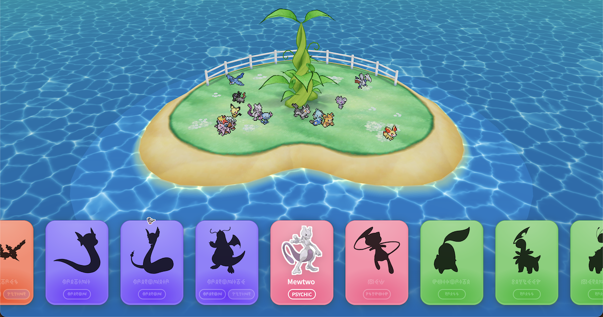

# PokéSky - Catch Pokémon live from Bluesky!

## [`Play it here!`](https://pokesky.idreesinc.com)

Like Poké Pelago, but for Bluesky!

*Notice: "Pokemon", "Pokédex", "Poké Pelago", and the assets used in this project are solely owned by the Pokémon Company, Game Freak, and Nintendo. As such, the license for this project does not apply to assets in this repository owned by the aforementioned companies.*

## Features

- See every post relating to Pokémon live on Bluesky, for better or worse!
- Catch over 1000+ Pokémon and collect ranks!
- Detailed 3D recreation of the Poké Pelago from the best generation of Pokémon games!
- Vibe code free!

## How to use

- Play it in your web browser [here](https://pokesky.idreesinc.com)
- Click on Pokémon as they appear live to catch them
- Unlock Pokémon and see them as they appear in your Pokédex

## Acknowledgements

- Water shader: https://github.com/cortiz2894/water-anime-shader
- Pixel sprites for gen 8 and beyond: https://play.pokemonshowdown.com/sprites
- Sprites, sounds, names, and images are all property of the Pokémon Company, Game Freak, and Nintendo

---

Let me know what you catch and feel free to reach out [@idreesinc.com](https://bsky.app/profile/idreesinc.com)!
